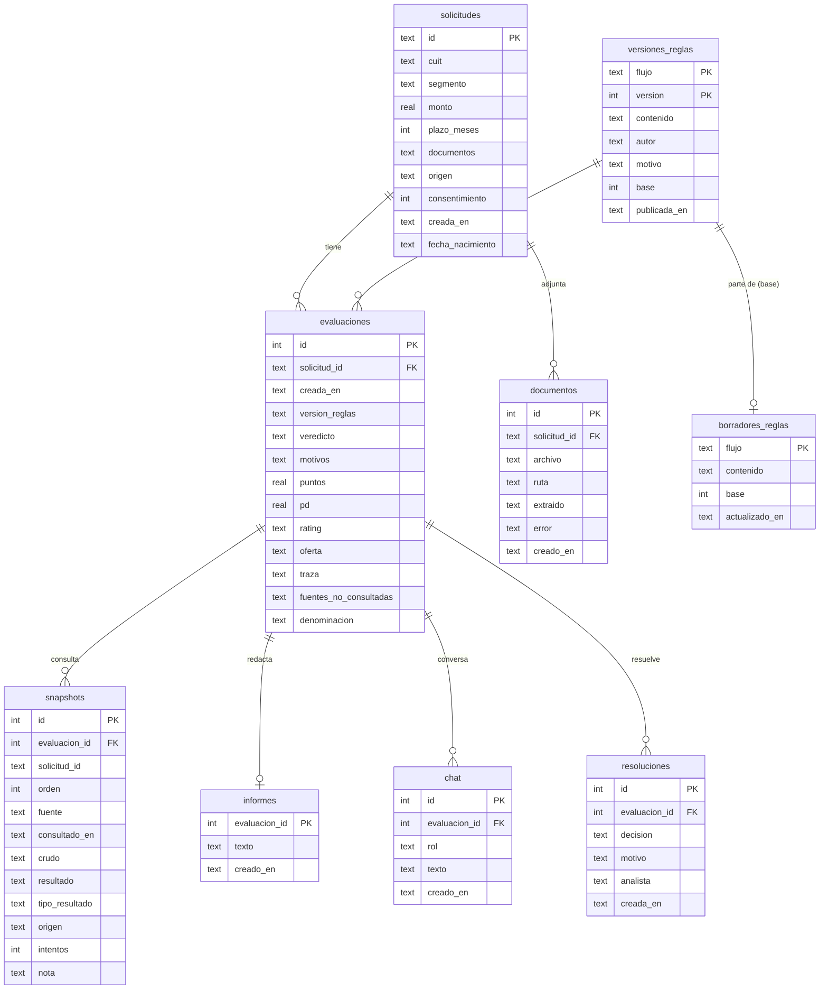

# DER de la base de trabajo (`data/relevo.sqlite`)

Diagrama entidad-relación del esquema de [`repositorio.py`](../src/relevo/repositorio.py) (constante `ESQUEMA`). Si cambia el esquema, hay que actualizar este diagrama.

## Notas

- Todas las claves foráneas son `ON DELETE CASCADE`: borrar una solicitud borra sus evaluaciones, documentos, snapshots, informe, chat y resoluciones.
- Una evaluación es inmutable: reevaluar agrega una fila nueva y vale la última.
- `snapshots.solicitud_id` repite el de la solicitud sin ser clave foránea: el almacén de snapshots lo usa para reutilizar consultas pagas entre evaluaciones de la misma solicitud (índice `snapshots_por_fuente`).
- `solicitudes.documentos` guarda las variables cargadas a mano en el alta. Los documentos subidos y lo que extrae el agente están en la tabla `documentos`.
- `evaluaciones.traza`, `motivos`, `oferta` y `snapshots.crudo` / `resultado` son JSON en columnas de texto.
- `versiones_reglas` guarda las reglas de cada flujo (ADR 0007). Es inmutable: publicar agrega una fila y la vigente es la de mayor `version`. `contenido` es el YAML de las reglas; las versiones sembradas desde `rules/` tienen autor `semilla`. No hay clave foránea con `evaluaciones`: la evaluación guarda el id `flujo.vN` como texto en `version_reglas`.
- `borradores_reglas` tiene a lo sumo un borrador por flujo, compartido. `contenido` es JSON todavía sin validar y `base` es la versión vigente de la que parte; publicar lo valida, crea la versión siguiente y borra el borrador.
- Los padrones `data/arca.sqlite` y `data/igj.sqlite` son snapshots de solo lectura, con otro esquema, y no forman parte de este diagrama.
