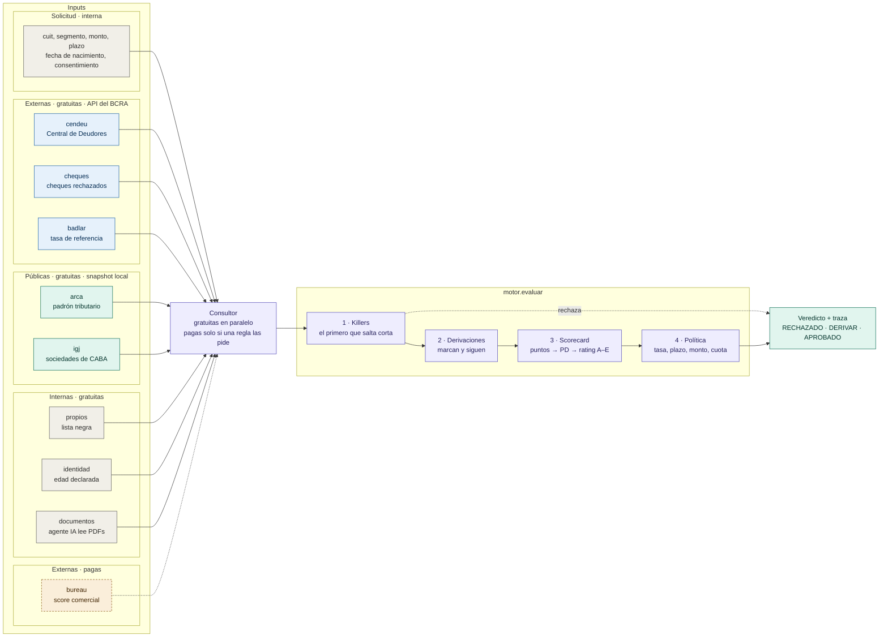

# Flujo del motor

`motor.evaluar(solicitud, reglas, consultor)` recibe una solicitud y devuelve un veredicto con su traza. El diseño de cada módulo está en [diseno-modulos.md](diseno-modulos.md) y la política de costo de las fuentes en [ADR 0005](adr/0005-fuentes-gratuitas-primero-pagas-bajo-demanda.md).

Colores de los inputs: gris = interno, azul = externo gratuito (API), verde = público con snapshot local, ámbar con borde punteado = pago.

## Inputs

| Fuente | Tipo | Costo | De dónde sale | Variables principales | Reglas v3 que la usan |
|---|---|---|---|---|---|
| `solicitud` | interna (pseudo-fuente que resuelve el propio motor) | sin costo | el alta de la solicitud | `cuit_valido`, `tipo_persona`, `monto`, `plazo_meses` | PyME y monotributista |
| `cendeu` | externa | gratuita | API del BCRA, Central de Deudores | `peor_situacion_12m`, `deuda_irregular_12m`, `proporcion_irregular_12m`, `entidades_con_deuda`, `deuda_total` | PyME y monotributista |
| `cheques` | externa | gratuita | API del BCRA, cheques rechazados | `rechazados_impagos` | PyME y monotributista |
| `badlar` | externa, global (no depende del solicitante) | gratuita | API de estadísticas del BCRA; si cae, usa el último valor guardado | `tasa` | PyME y monotributista (tasa base de la oferta) |
| `arca` | pública, snapshot local | gratuita | padrón público de ARCA en `data/arca.sqlite` | `inscripcion_vigente`, `categoria_monotributo`, `ganancias`, `iva`, `empleador` | PyME y monotributista |
| `igj` | pública, snapshot local | gratuita | datos.jus.gob.ar en `data/igj.sqlite` (solo sociedades de CABA) | `dada_de_baja`, `antiguedad_anios` | PyME |
| `propios` | interna | gratuita | lista negra de la entidad (hoy de juguete, `config/juguete.yaml`) | `lista_negra`, `creditos_previos` | PyME y monotributista |
| `identidad` | interna | gratuita | fecha de nacimiento declarada en el alta; RENAPER queda para producción | `edad`, `validada`, `origen` | monotributista |
| `documentos` | interna | gratuita | PDFs que el agente documental extrae, o carga manual | `ventas_anuales`, `antiguedad_actividad_anios`, `confianza_minima` | PyME y monotributista (variables distintas) |
| `bureau` | externa | **paga** | bureau comercial (hoy de juguete) | `score` | ninguna regla v3 |

Las fuentes gratuitas se precargan en paralelo al empezar. Las pagas se consultan solo cuando una regla las necesita por primera vez, y se reutilizan entre evaluaciones de la misma solicitud durante `reutilizar_dias` (ver [config/fuentes.yaml](../config/fuentes.yaml)). "Gratuita" no cuenta el costo de las llamadas al modelo del agente documental.

## Etapas

1. **Killers**: se evalúan en el orden del YAML, de lo más barato a lo más caro. El primero que salta rechaza y corta, sin pedir más fuentes.
2. **Derivaciones**: no cortan. Marcan la evaluación para un analista, y si algo posterior rechaza, el rechazo gana.
3. **Scorecard**: suma puntos por característica (con puntos propios si falta el dato), los convierte en probabilidad de default (PD) y asigna el rating A–E.
4. **Política**: rechaza los ratings configurados (hoy E), calcula la tasa (BADLAR más el spread del rating), el plazo, el monto por capacidad de pago y la cuota en sistema francés, y rechaza si el monto queda por debajo del mínimo.
5. **Veredicto**: `RECHAZADO` gana sobre `DERIVAR`, y `DERIVAR` sobre `APROBADO`. La traza guarda cada paso y qué fuentes no se llegaron a consultar.

Cuando una fuente no está disponible, cada regla aplica su `si_no_disponible` (continuar, derivar o rechazar), según el [ADR 0006](adr/0006-comportamiento-ante-fuente-no-disponible-configurable.md).
